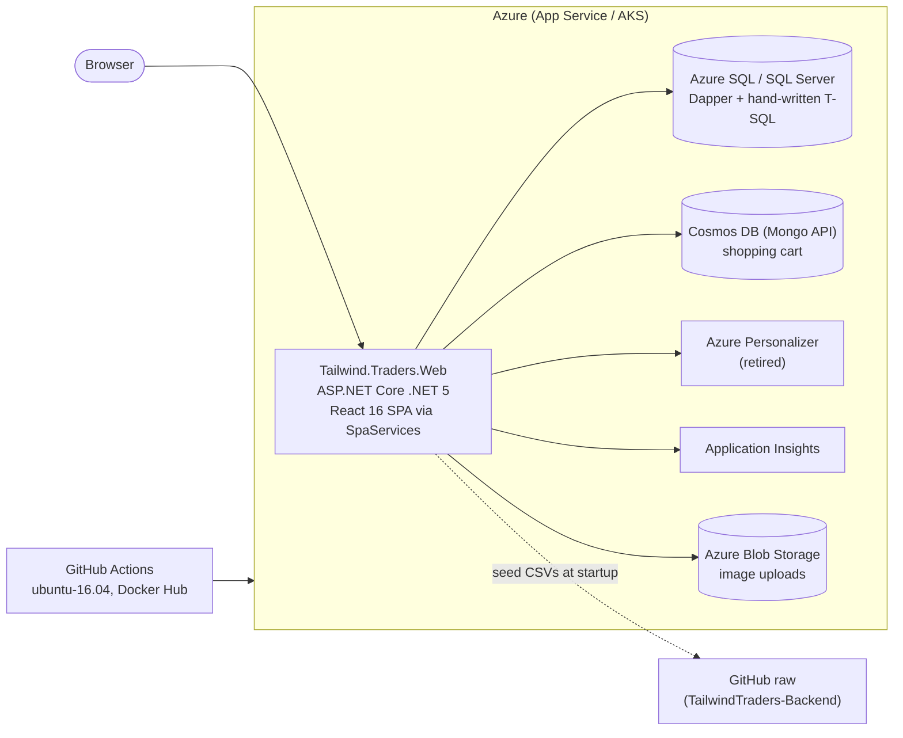
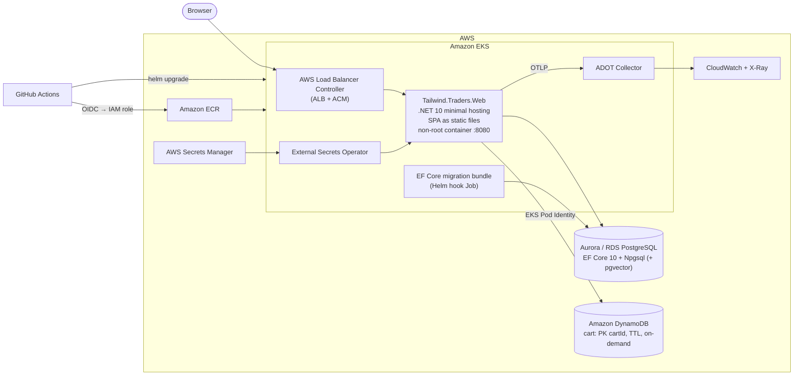

# Tailwind Traders — AI-assisted modernization

This fork is a customer-facing demo of using AI to modernize a legacy .NET web app, one reviewed PR per phase.
The full plan with estimates and risks is in [`/PLAN.md`](../../PLAN.md). Design decisions are recorded as [ADRs](adr/). The current-state data flow (before the database migration) is documented in [data-flow.md](data-flow.md).

## Goals
1. Upgrade from **.NET 5** (EOL 2022) to **.NET 10 LTS**.
2. Host on **Kubernetes** — **Amazon EKS** with Helm (local demo on kind).
3. Migrate the catalog database from **SQL Server → PostgreSQL** (Amazon Aurora/RDS) with **EF Core 10**.
4. Move the shopping cart from **MongoDB/Cosmos DB → Amazon DynamoDB**.
5. Add the production basics the legacy app lacks: tests, CI/CD, health checks, observability, secrets management.

## Before: legacy architecture

## After: target architecture

## Roadmap
| Phase | Scope | Status | PR |
|---|---|---|---|
| 0 | Baseline characterization tests (xUnit + WebApplicationFactory + Testcontainers) | ✅ Merged | [#1](https://github.com/zander-zilla/TailwindTraders-Website/pull/1) |
| 1 | .NET 5 → .NET 10, minimal hosting, package upgrades, legacy bug fixes, Node 22 frontend build | ✅ Merged | [#2](https://github.com/zander-zilla/TailwindTraders-Website/pull/2) |
| 2 | Hardened containers (chiseled, single-RID, Trivy gate, SBOM), local compose full stack | ✅ Merged | [#5](https://github.com/zander-zilla/TailwindTraders-Website/pull/5) |
| 3a | SQL Server → PostgreSQL 17 with EF Core 10 + Npgsql | ✅ Merged | [#6](https://github.com/zander-zilla/TailwindTraders-Website/pull/6) |
| 3b | Cart MongoDB → Amazon DynamoDB (PK user, SK product, TTL, server-side prices) | ✅ Merged | [#7](https://github.com/zander-zilla/TailwindTraders-Website/pull/7) |
| 4 | Kubernetes: new Helm chart, migrate hook Job, `/readyz`, kind (`scripts/kind-up.sh`) + EKS values (ALB, ESO/Secrets Manager, Pod Identity) | ✅ Merged (kind verified; EKS pending AWS account) | [#8](https://github.com/zander-zilla/TailwindTraders-Website/pull/8) |
| 5 | AWS IaC (Terraform: VPC, EKS Graviton, Aurora PG17 Serverless v2, DynamoDB, ECR, Pod Identity, GitHub OIDC) + `deploy-aws` CI/CD | ✅ Merged (code validated; **not applied** yet) | [#9](https://github.com/zander-zilla/TailwindTraders-Website/pull/9) |
| 6 | OpenTelemetry (traces/metrics/logs, browser → API → PostgreSQL/DynamoDB), Aspire dashboard locally, CloudWatch agent → X-Ray/Application Signals on EKS, HTTP resilience | ✅ Merged | [#10](https://github.com/zander-zilla/TailwindTraders-Website/pull/10) |
| 7 | Frontend: CRA → Vite 7, React 18, react-router 7; ACS/B2C/App Insights/Fluent removed; Vitest + Playwright | 🟡 In review | [#11](https://github.com/zander-zilla/TailwindTraders-Website/pull/11) |
| 8 | AI: semantic product search (pgvector + Bedrock Titan embeddings; offline provider locally), optional Bedrock RAG assistant | 🟡 In review | [#12](https://github.com/zander-zilla/TailwindTraders-Website/pull/12) |

## Data flow & containers
- [SQL Server → PostgreSQL data migration with AWS DMS](sqlserver-to-postgres-dms.md) (docs only) and the generated [idempotent schema script](catalog-schema.postgres.sql).
- [Container image before/after scan](container-scan.md): size and vulnerability comparison (Phase 2).
- [AI search](ai-search.md): pgvector + Bedrock semantic search, assistant, AWS checklist.
- [Observability](observability.md): what's instrumented, how to see traces locally (compose/kind) and in CloudWatch/X-Ray.
- [AWS setup](aws-setup.md): Terraform, bootstrap commands, GitHub variables, cost estimate, teardown.
- [Kubernetes: kind and EKS](kubernetes.md): chart, values, how to run on kind, and what EKS needs.
- [Current-state data flow](data-flow.md): stores, ER diagram, seeding, per-use-case sequence diagrams and Phase 3a/3b migration impact.

## Architecture Decision Records
| # | Decision | Status |
|---|---|---|
| [0001](adr/0001-dotnet10-lts-minimal-hosting.md) | .NET 10 LTS with minimal hosting | Accepted |
| [0002](adr/0002-spa-served-as-static-files.md) | Serve the React SPA as static files | Accepted |
| [0003](adr/0003-skiasharp-replaces-imagesharp.md) | SkiaSharp replaces ImageSharp | Accepted |
| [0004](adr/0004-remove-personalizer-and-app-insights-sdk.md) | Remove Azure Personalizer and the App Insights SDK | Accepted |
| [0005](adr/0005-fix-settings-secret-leak.md) | Fix connection-string leak via `/api/settings` | Accepted |
| [0006](adr/0006-target-aws.md) | Target AWS as the cloud platform | Accepted |
| [0007](adr/0007-ef-core-npgsql-over-dapper.md) | EF Core 10 + Npgsql instead of Dapper | Accepted |
| [0008](adr/0008-dynamodb-for-cart.md) | Amazon DynamoDB for the shopping cart | Accepted (implemented) |
| [0009](adr/0009-eks-and-helm.md) | Amazon EKS + Helm for hosting | Accepted (kind implemented, EKS pending) |
| [0010](adr/0010-github-oidc-to-aws.md) | GitHub Actions OIDC to AWS IAM | Accepted (code done, not applied) |
| [0011](adr/0011-container-hardening.md) | Container hardening: chiseled runtime, single-RID publish, scan gate | Accepted |
| [0012](adr/0012-opentelemetry-observability.md) | OpenTelemetry; Aspire dashboard locally, CloudWatch/X-Ray on AWS | Accepted |
| [0013](adr/0013-vite-react18-frontend.md) | Frontend: Vite + React 18 + react-router 7; drop Azure-only UI | Accepted |
| [0014](adr/0014-pgvector-bedrock-semantic-search.md) | Semantic search: pgvector + Amazon Bedrock (offline provider locally) | Accepted |
