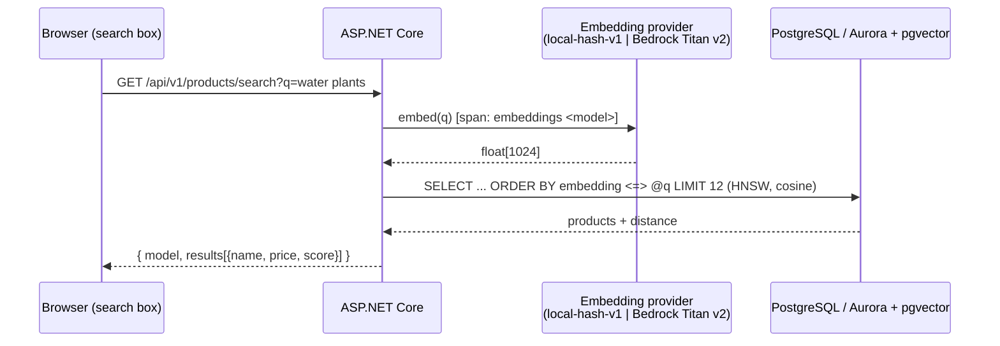

# AI: semantic product search (pgvector + Amazon Bedrock), Phase 8

Decision record: [ADR 0014](adr/0014-pgvector-bedrock-semantic-search.md).



The migrate step (compose `migrate` service / Helm hook Job) embeds every product: `name, name, category, feature descriptions`. It is idempotent and re-embeds only when the text or model changes.

## Try it locally (Mac, compose or kind)
```bash
cd ~/TailwindTraders-Website && git pull
cd TailwindTraders.Website/Source
docker compose -f docker-compose.standalone.yml up -d --build --remove-orphans   # Postgres image is now pgvector/pgvector:pg17
```
- UI: http://localhost:2000. Type into the **search box** in the header, e.g. `watering can for my garden`, `screwdrivers`, `refridgerator` (typo).
- API: `curl -s "http://localhost:2000/api/v1/products/search?q=drill&take=3" | jq`
- Traces: http://localhost:18888 shows `GET api/v1/products/search` → `product.semantic_search` → `embeddings local-hash-v1` + `postgresql`.
- kind: `scripts/kind-up.sh` (same URLs).

**The local provider is lexical, not semantic.** It matches words, plurals and typos, but not meaning. For example, "something to cut wood" ranks "Wood Pack" above "Wooden Saw". Use Bedrock to show real semantic matches.

### Use Amazon Bedrock from your laptop (optional)
With AWS credentials in your shell (for example `aws sso login`) and Titan v2 model access enabled:
```bash
export AWS_REGION=us-east-1 AWS_PROFILE=<profile>
# add to the web + migrate services' environment (or a compose override file):
#   Ai__EmbeddingProvider: bedrock
#   AWS_REGION / AWS_ACCESS_KEY_ID / AWS_SECRET_ACCESS_KEY / AWS_SESSION_TOKEN (from `aws configure export-credentials --format env`)
docker compose -f docker-compose.standalone.yml run --rm migrate   # re-embeds with amazon.titan-embed-text-v2:0
```

### Assistant (optional, off by default)
Set `Ai__Assistant__Enabled=true`, then:
`curl -s -XPOST localhost:2000/api/v1/assistant -H 'Content-Type: application/json' -d '{"question":"I need something to water my plants"}' | jq`
- With `bedrock`, the answer comes from Bedrock Converse (`amazon.nova-lite-v1:0`), grounded on the top-5 search hits.
- Otherwise it's an offline templated answer.

## Configuration (`Ai` section, env `Ai__*`)
| Key | Default | EKS (`values-eks.yaml` / Terraform `helm_values`) |
|---|---|---|
| `EmbeddingProvider` | `local` | `bedrock` |
| `EmbeddingModelId` | `amazon.titan-embed-text-v2:0` | `var.bedrock_embedding_model_id` |
| `Region` | (AWS_REGION) | `var.region` |
| `MinScore` | `0.2` | `0.15` |
| `EmbedOnMigrate` | `true` | `true` |
| `Assistant:Enabled` / `ModelId` / `MaxTokens` | `false` / `amazon.nova-lite-v1:0` / 400 | `var.assistant_enabled` / `var.bedrock_chat_model_id` |

## AWS checklist (John)
1. **Bedrock model access:** Bedrock console → Model access (in `var.region`) → enable **Titan Text Embeddings V2** (and **Nova Lite** if you want the assistant). Some regions only offer Nova through a cross-region inference profile; set `bedrock_chat_model_id = "us.amazon.nova-lite-v1:0"`.
2. `terraform apply`. The app Pod Identity role gets `bedrock:InvokeModel` on just those models.
3. Deploy (GitHub Actions `deploy-aws.yaml` or `helm upgrade`). The **pre-upgrade migrate Job** creates the `vector` extension on Aurora (as the master user, which has `rds_superuser`), creates the table and HNSW index, and embeds the catalog with Bedrock.
4. Check:
   - `curl https://<host>/api/v1/products/search?q=something%20to%20cut%20wood` returns `"model": "amazon.titan-embed-text-v2:0"`.
   - X-Ray / Application Signals shows the Bedrock dependency (`embeddings amazon.titan-embed-text-v2:0` + AWS SDK `BedrockRuntime.InvokeModel`).
- **Aurora + pgvector:** supported on Aurora PostgreSQL 17 (pgvector 0.8.x). No parameter-group change is needed. HNSW is fine at this size; tune `hnsw.ef_search` for large catalogs.
- **Cost:** Titan v2 is about $0.00002 per 1K tokens, so embedding the catalog costs well under a cent. Each search is one tiny call. The assistant (Nova Lite) costs fractions of a cent per question.

## Tests
`SemanticSearchTests` (Testcontainers `pgvector/pgvector:pg17`) covers:
- migrate embedded every product, idempotently, and the HNSW index exists
- expected products rank top-3 for `drill`, `watering can for my garden`, `screwdrivers`, `refridgerator`; scores are ordered
- nonsense query → no hits; empty query → 400
- `product.semantic_search` → `embeddings local-hash-v1` span with GenAI attributes
- the assistant is 404 by default and answers offline when enabled
- local embeddings are deterministic and unit-norm

Also covered elsewhere:
- **Vitest:** the search results page.
- **Playwright:** header search → results.
- **CI:** compose and kind jobs query the search API.
