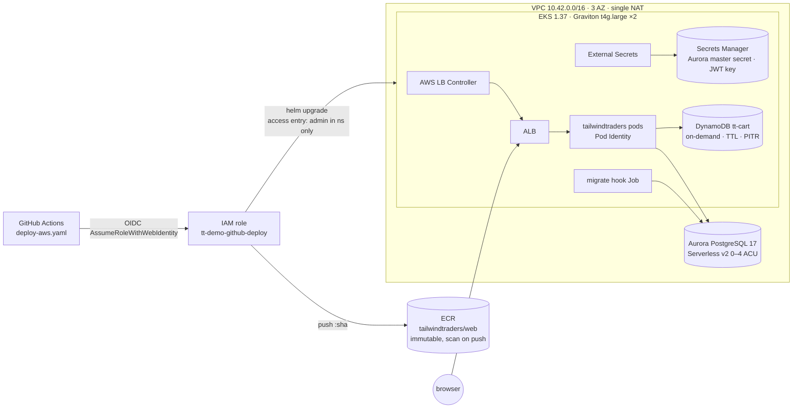

# AWS setup: Terraform + GitHub Actions deploy (Phase 5)

> **Status: code only, not applied.** No AWS account was available when Phase 5 was written. Everything below is statically validated (`terraform validate`, tflint, checkov, actionlint, helm/kubeconform), but **nothing has been deployed to AWS yet**. Expect small fixes on the first real `apply`.



## What's in `infra/terraform`
| File | Resources |
|---|---|
| `network.tf` | `terraform-aws-modules/vpc` 6.x: 3 AZs, private /20s (pods), public (ALB, tagged `kubernetes.io/role/elb`), database subnets, **one NAT gateway** (demo cost; not AZ-resilient). |
| `eks.tf` | `terraform-aws-modules/eks` 21.x: **Kubernetes 1.37**, public endpoint (CIDR-restrictable), managed node group **AL2023 arm64 (Graviton) t4g.large ×2** (2–4). EKS add-ons: vpc-cni, kube-proxy, coredns, **eks-pod-identity-agent**, **metrics-server**. Access entries: the apply identity (cluster admin), optional `admin_principal_arns`, and the **GitHub deploy role (admin in the `tailwindtraders` namespace only)**. |
| `addons.tf` | Helm: **AWS Load Balancer Controller** 3.6.0, **External Secrets Operator** 2.12.0, ClusterSecretStore `aws-secrets-manager` (via `bedag/raw`, limited to the app namespace), namespace `tailwindtraders` with Pod Security `restricted`. |
| `data.tf` | **ECR** `tailwindtraders/web` (IMMUTABLE tags, scan on push, keep last 30). **DynamoDB** `tt-cart` (PK `userId` S / SK `productId` N, PAY_PER_REQUEST, TTL `expiresAt`, PITR, SSE). **Aurora PostgreSQL 17.5 Serverless v2** (0–4 ACU, auto-pause after 30 min idle, encrypted, **RDS-managed master secret**, SG ingress only from EKS nodes). **JWT key** in Secrets Manager. |
| `identity.tf` | **Pod Identity** roles: app (`dynamodb:Query/GetItem/UpdateItem/DeleteItem/DescribeTable` on `tt-cart` + read on its two secrets), ESO (read the two secrets), LB Controller. **GitHub OIDC provider** + deploy role trusted **only** for `repo:zander-zilla/TailwindTraders-Website:ref:refs/heads/main` and `…:environment:aws`. Permissions: ECR push to the one repo, `eks:DescribeCluster`. |
| `dns.tf` | Optional: ACM certificate for `domain_name`, DNS-validated in `route53_zone_id`. |
| `outputs.tf` | `github_variables` (map → GitHub repo variables), `helm_values` (overlay for manual Helm), `kubeconfig_command`, and the individual endpoints/ARNs. |
| `backend.tf` | S3 remote state (commented, with instructions; S3-native locking). |

## Terraform output → Helm values mapping
| Helm value (`values-eks.yaml`) | Terraform output | GitHub variable |
|---|---|---|
| `image.repository` | `ecr_repository_url` | `ECR_REPOSITORY_URL` |
| `image.tag` | — (commit SHA) | — |
| `config.Cart__TableName` / `Cart__Region` | `cart_table_name` / `region` | `CART_TABLE_NAME` / `AWS_REGION` |
| `secrets.externalSecret.dbSecretKey` | `aurora_master_secret_arn` | `AURORA_SECRET_ARN` |
| `secrets.externalSecret.dbHost` (`dbPort` 5432) | `aurora_endpoint` | `AURORA_ENDPOINT` |
| `secrets.externalSecret.jwtSecretKey` | `jwt_secret_name` | `JWT_SECRET_NAME` |
| `ingress.host`, `certificate-arn` (+HTTPS listen/redirect) | var `domain_name`, `acm_certificate_arn` | `APP_HOST`, `ACM_CERTIFICATE_ARN` |
| (deploy plumbing) | `github_deploy_role_arn`, `cluster_name` | `AWS_ROLE_ARN`, `EKS_CLUSTER_NAME` |

Note: the RDS-managed master secret contains only `username`/`password`, so the host comes from Terraform. The demo app connects as the master user; a least-privilege DB user is a follow-up.

## Prerequisites (John)
- An **AWS account id** and a **region** (e.g. `us-east-1`; `ca-central-1` works too, since every service used is available there).
- An admin-capable identity for the one-time bootstrap (SSO profile), plus the IAM role ARN you'll use with kubectl (→ `admin_principal_arns`).
- **Optional domain**: an FQDN plus a Route 53 hosted zone id for HTTPS. Without it you get plain HTTP on the ALB hostname.
- Tools: `terraform >= 1.9`, `aws` CLI v2, `kubectl`, `helm`, `gh`, `jq` (`brew install terraform awscli kubectl helm gh jq`).
- Whether the account already has the GitHub OIDC provider (`aws iam list-open-id-connect-providers`). If yes, set `create_github_oidc_provider = false`.

## Bootstrap (one time, ~25–35 min, mostly EKS + Aurora)
```bash
export AWS_PROFILE=<admin-profile> AWS_REGION=us-east-1
cd TailwindTraders-Website/infra/terraform

# 1) (recommended) remote state
ACCOUNT=$(aws sts get-caller-identity --query Account --output text)
aws s3api create-bucket --bucket tt-demo-tfstate-$ACCOUNT --region $AWS_REGION   # add --create-bucket-configuration LocationConstraint=$AWS_REGION outside us-east-1
aws s3api put-bucket-versioning --bucket tt-demo-tfstate-$ACCOUNT --versioning-configuration Status=Enabled
#    then uncomment backend.tf and fill bucket/region

# 2) variables
cp terraform.tfvars.example terraform.tfvars    # set account_id, region, (admin_principal_arns, domain_name, route53_zone_id)

# 3) apply
terraform init
terraform plan -out tf.plan
terraform apply tf.plan

# 4) kubectl access + sanity checks
$(terraform output -raw kubeconfig_command)
kubectl get nodes -o wide                      # arm64 Graviton nodes
kubectl -n kube-system get deploy aws-load-balancer-controller
kubectl get clustersecretstore aws-secrets-manager   # STATUS Valid

# 5) GitHub repository variables (not secrets) for deploy-aws.yaml
terraform output -json github_variables | jq -r 'to_entries[] | "\(.key)\t\(.value)"' |
  while IFS=$'\t' read -r k v; do gh variable set "$k" --body "$v" --repo zander-zilla/TailwindTraders-Website; done

# 6) first deploy: Actions → deploy-aws → Run workflow (or push to main)
gh workflow run deploy-aws.yaml --repo zander-zilla/TailwindTraders-Website --ref main
gh run watch --repo zander-zilla/TailwindTraders-Website

# 7) URL
kubectl -n tailwindtraders get ingress tailwindtraders -o jsonpath='{.status.loadBalancer.ingress[0].hostname}'; echo
#    with a domain: create a Route 53 alias/CNAME domain_name -> that hostname
```
Optional: under repo Settings → Environments → `aws`, add required reviewers to gate production deploys (the role trusts that environment).

Manual deploy without CI:
```bash
terraform -chdir=infra/terraform output -raw helm_values > deploy/helm/tailwindtraders/values-eks.generated.yaml
helm upgrade --install tailwindtraders deploy/helm/tailwindtraders -n tailwindtraders \
  -f deploy/helm/tailwindtraders/values-eks.yaml -f deploy/helm/tailwindtraders/values-eks.generated.yaml \
  --set image.tag=<sha-already-in-ECR> --wait
```

## Estimated monthly cost (rough)
us-east-1 on-demand list prices, always on, light demo traffic. **Caveats:** prices vary by region and change over time, data transfer and NAT processing scale with traffic, there are no Savings Plans or free tier, and taxes are excluded. Check the AWS Pricing Calculator before committing.

| Item | Basis | ~USD / month |
|---|---|---|
| EKS control plane | $0.10/h | 73 |
| 2 × t4g.large nodes (+ 2 × 20 GB gp3) | ~$0.067/h each | 100 |
| NAT gateway (single) | $0.045/h + $0.045/GB | 33 + data |
| Application Load Balancer | $0.0225/h + LCUs | 18–25 |
| Public IPv4 addresses (NAT + ALB) | $0.005/h each, ~4 | ~15 |
| Aurora Serverless v2 | $0.12/ACU-h; **min 0 ACU = auto-pause**; e.g. 0.5–1 ACU for 4 h/day | 10–20 (≈ 45–90 if it never pauses at 0.5–1 ACU) |
| Aurora storage + I/O | $0.10/GB-month, tiny DB | 1–3 |
| DynamoDB on-demand + PITR | pennies at demo scale | < 1 |
| ECR (≤ 30 images × ~250 MB) | $0.10/GB-month | ~1 |
| Secrets Manager (2 secrets) | $0.40 each | 1 |
| CloudWatch Logs (control plane logs off by default) | | 1–5 |
| **Total** | | **≈ $250–300 / month** while running |

Cost levers: run `terraform destroy` between demos (the biggest saving), use 1 node (`node_desired_size = 1`, min 1), or switch to EKS Auto Mode or Fargate later.

## Teardown
```bash
# 1) remove the app first so the LB Controller deletes the ALB/target groups (otherwise the VPC destroy blocks)
helm uninstall tailwindtraders -n tailwindtraders
kubectl delete namespace tailwindtraders --wait   # also removes hook-managed ConfigMap/Secret/ExternalSecret
kubectl get ingress -A                             # should be empty; wait ~1–2 min for the ALB to disappear
# 2) destroy infra
cd infra/terraform && terraform destroy
# 3) optional: unset GitHub variables (deploy-aws then skips again)
for v in AWS_ROLE_ARN AWS_REGION EKS_CLUSTER_NAME ECR_REPOSITORY_URL AURORA_ENDPOINT AURORA_SECRET_ARN JWT_SECRET_NAME CART_TABLE_NAME APP_HOST ACM_CERTIFICATE_ARN; do gh variable delete $v --repo zander-zilla/TailwindTraders-Website; done
```
With `deletion_protection = false` (the default) Aurora skips the final snapshot, ECR is force-deleted, and the JWT secret is deleted immediately. Set it to `true` for anything long-lived.

## Accepted checkov findings (demo trade-offs)
Listed in `infra/terraform/.checkov.yaml`: AWS-managed KMS keys instead of customer-managed keys (ECR, DynamoDB, Secrets Manager); no rotation on the demo JWT key; module sources pinned by registry version rather than commit hash; first 3 AZs selected by slicing. Everything else passes (43 checks).

## Validation (no AWS calls)
- `terraform fmt -check`, `terraform init -backend=false`, `terraform validate`: ✅ (Terraform 1.16.5, AWS provider 6.x).
- `tflint` (AWS ruleset): ✅ no issues. `checkov`: 43 passed, 0 failed (with the accepted skips above).
- `actionlint` on `deploy-aws.yaml` and `terraform.yaml`: ✅.
- The EKS chart values are rendered with deploy-style `--set` overrides (including the TLS annotations) and pass kubeconform.
- CI: `terraform` workflow (fmt/validate/tflint/checkov). `deploy-aws` skips with a notice until `AWS_ROLE_ARN` is set.
