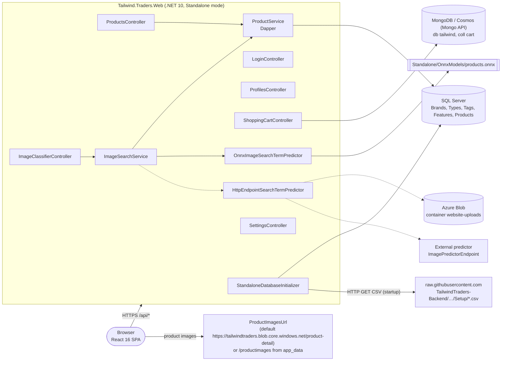
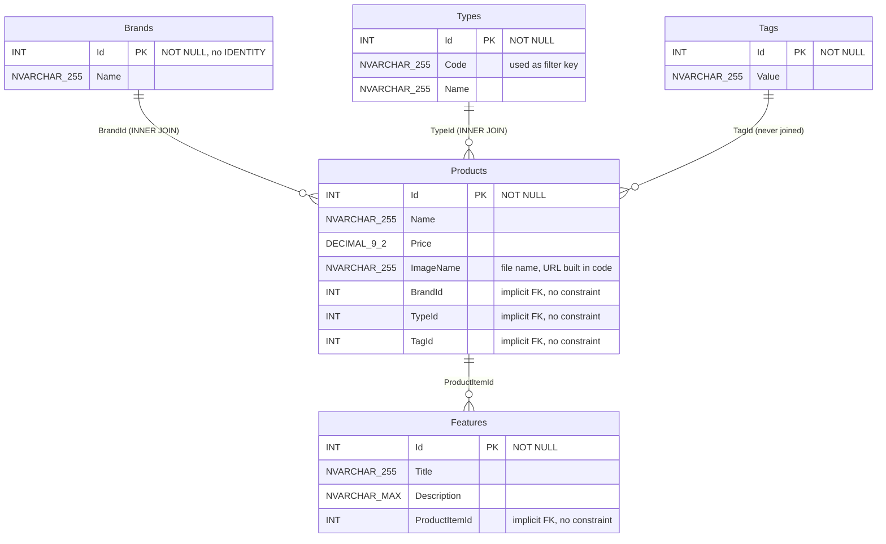
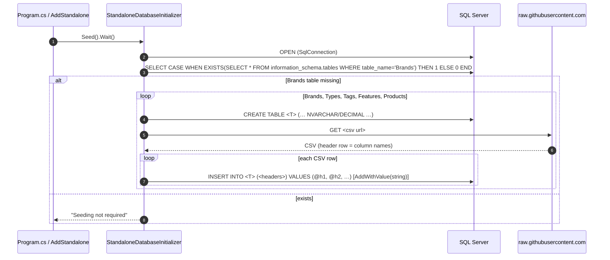
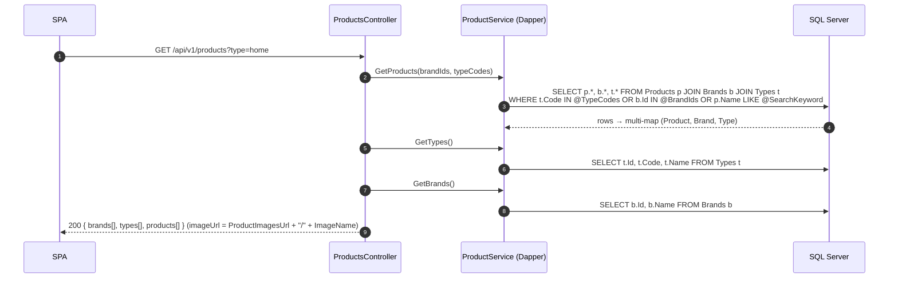
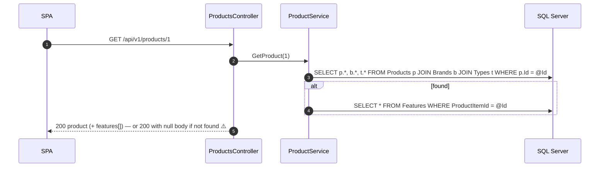
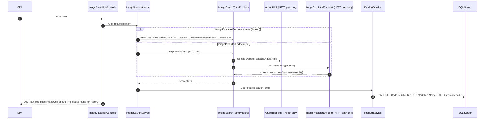
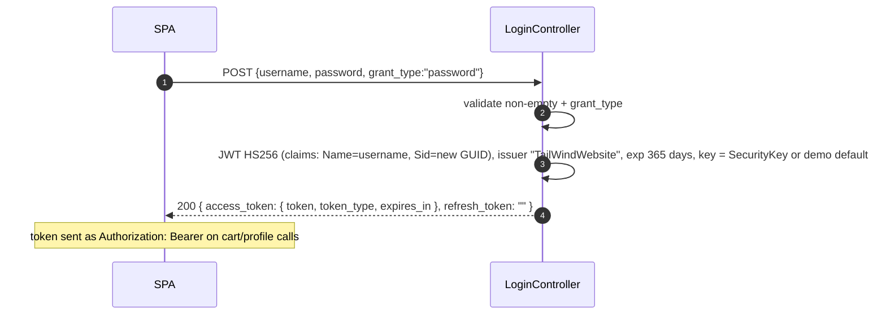
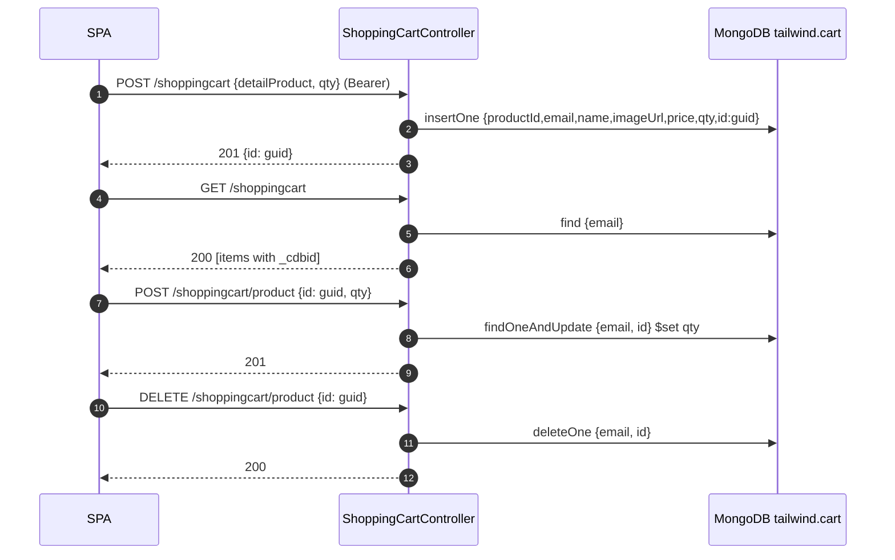

# Current-state data flow (before database modernization)

> Derived from the code on branch `phase-1-dotnet10` (after the .NET 10 upgrade, **before** Phase 3a PostgreSQL/EF Core and Phase 3b DynamoDB).
> **Update (Phase 3b):** the cart now runs on Amazon DynamoDB (DynamoDB Local for development). Section 2.2 and the cart sequence diagrams describe the legacy MongoDB behavior.
> **Update (Phase 3a):** the catalog now runs on PostgreSQL 17 + EF Core 10. Sections 2.1, 3 and 4.1–4.4 describe the *legacy* SQL Server behavior, kept for reference. See the "Phase 3a status" column in the [migration impact](#6-migration-impact) table for what changed.
> Applies to **Standalone mode**, where the web app hosts its own APIs. It is enabled when `SqlConnectionString` is set (`ConfigExtensions.IsStandaloneEnabled`). In "frontend-only" mode the SPA calls the external TailwindTraders-Backend microservices instead (`ApiUrl`, `ApiUrlShoppingCart`); that mode is out of scope.
>
> **Verification legend:** ✅ verified at runtime by the baseline tests or manual curl (Phase 0/1) · ⚠️ derived from code only, not exercised at runtime.

Key source files (under `TailwindTraders.Website/Source/Tailwind.Traders.Web/`):

| Concern | File |
|---|---|
| DI / wiring, Mongo client, JWT, seeding trigger | `Standalone/ConfigExtensions.cs` |
| Schema creation + seeding | `Standalone/Data/DatabaseInitializer.cs` (`StandaloneDatabaseInitializer`) |
| Catalog queries (Dapper) | `Standalone/Services/ProductService.cs` |
| Cart (MongoDB) | `Standalone/Controllers/ShoppingCartController.cs`, `Standalone/Data/ShoppingCartItemDocument.cs` |
| Image search | `Standalone/Services/ImageSearchService.cs`, `OnnxImageSearchTermPredictor.cs`, `HttpEndpointSearchTermPredictor.cs` |
| Login / profile | `Standalone/Controllers/LoginController.cs`, `ProfileController.cs` |
| SPA settings | `Controllers/SettingsController.cs`, `Settings.cs` |

There is **no repository layer**. Controllers call `ProductService` (Dapper on a scoped `SqlConnection`) or the `MongoClient` directly.

---

## 1. Context diagram



---

## 2. Data stores

### 2.1 SQL Server: catalog (created by the app at startup)

DDL is in `StandaloneDatabaseInitializer.Create*Table` (T-SQL strings). **No foreign keys, indexes (other than the PKs), IDENTITY, schemas, stored procedures or views.** Relationships are implicit and used only in JOINs.



Seeded volume ✅: 4 brands, 7 types, 70 products. Product 1 = "Microwave 0.9 Cu. Ft. 900 W", 100.00. Type codes are `decor, diytools, gardening, home, homeappliances, kitchen, sink`.

### 2.2 MongoDB: shopping cart

- Client: singleton `MongoClient` from `MongoConnectionString` (default `mongodb://localhost:27017`).
- Database `tailwind`, collection `cart`. **One document per cart line** (no cart aggregate document). No indexes are created by the app.

```jsonc
// ShoppingCartItemDocument (BSON element names)
{
  "_id":       ObjectId,          // [BsonId]; hidden from JSON via [JsonIgnore]
  "productId": 1,                 // int   (C# Id)
  "email":     "user@contoso.com",// string = JWT ClaimTypes.Name (the login username); the "user key"
  "imageUrl":  "https://…/x.jpg", // string, copied from the client request
  "name":      "Microwave …",     // string, copied from the client request
  "price":     { "$numberDecimal": "100.00" }, // C# decimal; driver default representation (⚠️ not verified)
  "qty":       2,                 // int
  "id":        "3f2c…-guid"       // string GUID generated server-side; exposed to the SPA as "_cdbid"
}
```

### 2.3 Blob storage (Azure) ⚠️
- Used **only** by `HttpEndpointSearchTermPredictor`, which is active when `ImagePredictorEndpoint` is set. It needs `StorageConnectionString`. The uploaded image is resized to max 500 px, encoded as JPEG and written to container **`website-uploads`** as `<guid>.jpg`. The blob URL is appended to `ImagePredictorEndpoint` and called with GET.
- Product images are **not** stored by the app. The URL is `{ProductImagesUrl}/{ImageName}`, defaulting to the public Azure blob `tailwindtraders.blob.core.windows.net/product-detail`. Alternatively the app serves `app_data/productimages` at `/productimages` if that folder exists.

### 2.4 ONNX model files
- `Standalone/OnnxModels/products.onnx`, copied to the output (`CopyToOutputDirectory=PreserveNewest`) and loaded once by the **singleton** `OnnxImageSearchTermPredictor` (`InferenceSession`).
- Input `data` is a float tensor [1,3,224,224] in BGR channel order with **x/y transposed** (`data[0,c,x,y]`). Output `classLabel` is a string label that becomes a product-name search term.

---

## 3. Seeding flow (app startup) ✅

Triggered synchronously from `AddStandalone(...)` during service registration via `initializer.Seed().Wait()`, which blocks startup.



CSV sources (base `https://raw.githubusercontent.com/microsoft/TailwindTraders-Backend/main/Source/Services/Tailwind.Traders.Product.Api/Setup/`):

| Table | CSV |
|---|---|
| Brands | `ProductBrands.csv` |
| Types | `ProductTypes.csv` |
| Tags | `ProductTags.csv` |
| Features | `ProductFeatures.csv` |
| Products | `ProductItems.csv` |

Notes for migration:
- Column names come **from the CSV header** and are interpolated into the INSERT text. The CSV and DDL must match exactly.
- Every value is bound as a **string** (`AddWithValue(header, GetField(header))`). SQL Server implicitly converts to INT/DECIMAL; **PostgreSQL will not** (an explicit cast or typed mapping is needed).
- Row-by-row INSERTs with no transaction. A partial failure leaves a half-seeded DB, and only the existence of `Brands` is checked, so a rerun will not repair it.
- Startup has a hard dependency on GitHub availability and on the `microsoft/TailwindTraders-Backend` repo layout.

---

## 4. Use cases

### 4.0 SPA settings: `GET /api/settings` ✅
`SettingsController.GetSettings` returns the bound `Settings` object (from config, no DB access). Phase 1 fixed the leak of `SqlConnectionString`/`MongoConnectionString` ([ADR 0005](adr/0005-fix-settings-secret-leak.md)).
⚠️ **Still exposed:** `Settings.Cart` (`Host`, `AuthKey`, `DatabaseId`, `ContainerId`), which is the Cosmos key for the legacy **browser-side** Cosmos DAO. `Clone()` also copies `ContainerId` into `DatabaseId` (bug). See Surprises.

### 4.1 Home / product list and filters: `GET /api/v1/products?type=<code>&brand=<id>` ✅
`ProductsController.GetProducts(int[] brand, string[] type)` → `ProductService.GetProducts(brand, type)` + `GetTypes()` + `GetBrands()`. The SPA (`productsService.getFilteredProducts`) sends repeated query params (`qs` `arrayFormat: 'repeat'`).



- Three sequential round trips on one connection. `OpenConnection()` **swallows all exceptions**, so if the connection is already open or broken the error surfaces later.
- **Filter semantics are OR** across type, brand and search. With no filter, every predicate is false or NULL and the result is **0 products** ✅ (pinned in tests).
- SQL Server-specific / migration-relevant:
  - `IN @TypeCodes` / `IN @BrandIds` uses **Dapper list expansion** into `(@p1,@p2,…)`. An **empty array expands to `IN (SELECT @p WHERE 1 = 0)`**, Dapper's SQL Server-style trick; with Npgsql use `= ANY(@arr)`, or LINQ `Contains`.
  - `t.Code IN …` comparisons are **case-insensitive** under the default SQL Server collation (`SQL_Latin1_General_CP1_CI_AS`) and case-sensitive in PostgreSQL.
  - Unquoted mixed-case identifiers (`Products`, `BrandId`) fold to lowercase in PostgreSQL. EF Core with snake_case naming avoids this.
  - The select list includes `TagId`, but `Product` has no `TagId` property, so it is silently dropped.
- `GET /api/v1/products/landing` returns a hard-coded `[]` ✅. No data access.

### 4.2 Product detail: `GET /api/v1/products/{id}` ✅



- `SELECT *` on Features is mapped by column name; `ProductItemId` has no matching property and is ignored.
- `StockUnits` is a hard-coded model default of **100** and not stored.
- Not found returns `Ok(null)` (204/200 with empty body ⚠️, not 404). An EF rewrite should decide this deliberately.

### 4.3 Text search ⚠️ (internal only)
There is **no public text-search endpoint** in Standalone mode. `ProductService.GetProducts(searchTerm:)` (`p.Name LIKE '%term%'`) is called **only by image search** (4.4).
- `LIKE` is case-insensitive in SQL Server (CI collation) and **case-sensitive in PostgreSQL**, so use `ILIKE` / `EF.Functions.ILike`. The ONNX labels are lowercase (e.g. "hammer") while product names are capitalized, so **search breaks silently on PostgreSQL without ILIKE**.
- A leading `%` means no index can be used (a full scan, fine at 70 rows; consider `pg_trgm` later).
- The search term is not escaped, so `%`/`_` in the term act as wildcards.

### 4.4 Image search: `POST /api/v1/products/imageclassifier` (multipart `file`) ✅ (ONNX path) / ⚠️ (HTTP path)



- The HTTP path creates a `new HttpClient()` per call. It uploads to blob storage before prediction and **never deletes uploads** ⚠️.
- The default fallback path is the ONNX model, which is covered by a smoke test.

### 4.5 Login / JWT: `POST /api/v1/login` ✅
`LoginController.Login(TokenRequest{username,password,grant_type})`. **No data store**: any non-empty username/password with `grant_type=password` is accepted (demo).



- The username (usually an email) becomes `User.Identity.Name`, which is the **cart partition key** today.
- Validation (`ConfigExtensions`) checks the signing key only. Issuer, audience and lifetime are not strictly validated beyond the defaults.

### 4.6 Cart: `/api/v1/shoppingcart` (`[Authorize]`; 401 anonymous since Phase 1) ✅

All operations use `mongoClient.GetDatabase("tailwind").GetCollection<ShoppingCartItemDocument>("cart")` with `userId = User.Identity.Name`.

| Use case | Endpoint | Mongo operation | Response |
|---|---|---|---|
| Get cart | `GET /api/v1/shoppingcart` | `Find({ email: userId })` → list | 200 `[ {id(productId), email, imageUrl, name, price, qty, _cdbid} ]` |
| Add item | `POST /api/v1/shoppingcart` body `{detailProduct{id,name,imageUrl,price}, qty}` | `InsertOne({productId, email, name, imageUrl, price, qty, id: newGuid})` | 201 `{message, id: guid}` |
| Update qty | `POST /api/v1/shoppingcart/product` body `{id: guid, qty}` | `FindOneAndUpdate({email: userId, id: guid}, $set qty)` | 201 (even if nothing matched) |
| Delete item | `DELETE /api/v1/shoppingcart/product` body `{id: guid}` | `DeleteOne({email: userId, id: guid})` | 200 (even if nothing matched) |
| Related products | `GET /api/v1/shoppingcart/relatedproducts?type=` | none, returns `[]` | 200 |



- **Access patterns for DynamoDB:** (1) get all lines for a user, (2) put a line, (3) update qty of one line by user + line id, (4) delete one line by user + line id. No cross-user queries, no scans needed.
- Adding the same product twice creates **two lines** (no upsert by productId). The SPA's `cartService` increments the qty of an existing line client-side via `_cdbid`.
- Name, price and imageUrl are **trusted from the client** and not re-read from the catalog.
- No TTL or expiry; carts live forever. No indexes on `email` / `id`, so Mongo does collection scans.

### 4.7 Profile: `GET /api/v1/profiles/navbar/me` (`[Authorize]`) ✅
`ProfilesController.GetMe` returns a **hard-coded profile** with `Email = User.Identity.Name`. No data store.

### 4.8 Endpoints the SPA calls that Standalone mode does **not** implement ⚠️
`GET {ApiUrl}/coupons` and `GET {ApiUrl}/profiles/me` (full profile with purchase history and favourite categories) exist only in the external TailwindTraders-Backend. In Standalone they match no controller. Since Phase 1 a GET falls through to the SPA fallback and returns **`index.html` with 200**. (The legacy .NET 5 `UseSpa` behaved similarly.) The coupons and profile pages therefore get HTML instead of JSON.

---

## 5. Surprises found while tracing the code
1. **The `Tags` table is created and seeded but never read**, and `TagId` is selected but dropped by the mapper.
2. **No foreign keys, no indexes, no IDENTITY**: relationships are implicit. Ids come from the CSVs.
3. **Seed inserts bind every value as a string** and rely on SQL Server implicit conversion. They are row-by-row with no transaction and only check that `Brands` exists.
4. **Startup downloads seed data from GitHub synchronously**, blocking app start.
5. **Unfiltered product list returns 0 rows** (OR-of-filters semantics).
6. **Text search exists only inside image search**; search depends on SQL Server's case-insensitive collation.
7. **`/api/settings` still exposes `Settings.Cart.AuthKey`** (Cosmos key for a browser-side Cosmos DAO). The frontend `cosmosdb/` DAO is **not imported anywhere** (dead code), but the key would still be sent if configured. `Clone()` maps `DatabaseId = ContainerId`.
8. **Cart trusts client-supplied price/name** and creates duplicate lines for the same product. Update/delete return success even when nothing matched.
9. **Coupons and full-profile endpoints are missing in Standalone** and return `index.html` (200).
10. `ProductService.OpenConnection()` swallows exceptions. The HTTP image predictor news up an `HttpClient` per request and never cleans up blob uploads.

---

## 6. Migration impact

| Flow | Current (code) | Phase 3a: PostgreSQL + EF Core 10 | Phase 3b: DynamoDB cart | Notes / tests | Phase 3a/3b status |
|---|---|---|---|---|---|
| Schema creation | T-SQL `CREATE TABLE` strings at startup | EF Core entities + migrations (migration bundle as Helm hook Job). Add **FKs** + indexes (`products.brand_id/type_id`, `features.product_item_id`); `numeric(9,2)`, `varchar(255)`/`text` | n/a | Decide whether to keep or drop `Tags` (unused) | ✅ Done: EF migration `InitialCatalog`, FKs, FK indexes, unique `types.code`; `Tags` kept (FK from products) but still unused by the API |
| Seeding | Runtime CSV download, string-bound INSERTs | Vendor CSVs in repo; typed parse (CsvHelper class maps) → `HasData`/`UseAsyncSeeding` or Npgsql `COPY`; one transaction; idempotent | n/a | Golden counts 4/7/70 must hold | ✅ Done: vendored CSVs, CsvHelper class maps, one transaction, insert-missing-by-Id; run via `--migrate` |
| Product list + filters | Dapper multi-map, `IN @list`, OR semantics, CI collation | LINQ `Include(Brand, Type)`, `typeCodes.Contains(t.Code)` (→ `= ANY`); keep OR semantics; case-insensitive match on `code` (citext/`ILike`/normalize to lowercase); decide whether unfiltered should return all | n/a | `type=home` → 8 | ✅ Done: LINQ `Contains` (`= ANY`), OR semantics kept, type codes lower-cased; **unfiltered still returns 0** (kept deliberately); results now ordered by id |
| Product detail | 2 queries + `SELECT *` Features | `Include(Features)`, `AsNoTracking`; decide 404 vs null | n/a | Product 1 golden values | ✅ Done: `Include` + `AsSplitQuery`, features ordered by id; not-found still `Ok(null)` (kept) |
| Text search (internal) | `LIKE '%term%'` (CI) | **`EF.Functions.ILike`** (or `citext`/`pg_trgm`); escape `%`/`_` | n/a | Add a test: lowercase term matches capitalized name | ✅ Done: `EF.Functions.ILike` + escaped wildcards (tests for lower/upper case and `%`/`_`) |
| Image search | ONNX → `LIKE` search; optional Azure Blob upload | Uses the new search; no other DB change | n/a | Blob → **S3** later (ADR 0006) | ✅ Works on Postgres (smoke test + manual 200) |
| Login / JWT | Stateless | none | Username/`sub` becomes the cart partition key | Consider a stable user id claim instead of the name | unchanged |
| Get cart | `find({email})` | n/a | **`Query` PK `cartId = <user/session id>`** | Same JSON shape incl. `_cdbid` | ✅ 3b: `Query` PK `userId` (JWT name), consistent read; same JSON incl. `_cdbid` (= productId) |
| Add to cart | `insertOne` (dup lines) | n/a | `PutItem` (PK cartId, **SK productId** → upsert/increment qty per product) + `expiresAt` TTL | Behaviour change: duplicates merge; update the golden test | ✅ 3b: `UpdateItem ADD qty` (atomic merge), name/price/image from the catalog (client values ignored), TTL `expiresAt` |
| Update qty | `findOneAndUpdate({email,id})` | n/a | `UpdateItem` key (cartId, productId) with `ConditionExpression attribute_exists` → 404 when missing | Today addressed by line GUID (`_cdbid`); keep `_cdbid` = productId or keep a GUID attribute for UI compatibility | ✅ 3b: conditional `UpdateItem` → 404 when missing; qty < 1 → 400 |
| Delete item | `deleteOne({email,id})` | n/a | `DeleteItem` key (cartId, productId) | | ✅ 3b: `DeleteItem ALL_OLD` → 404 when nothing deleted |
| Related / landing | Hard-coded `[]` | Optional: implement via catalog (or pgvector in Phase 8) | n/a | | unchanged |
| Profile | Hard-coded | none | none | | unchanged |
| Settings | Exposes `Cart.AuthKey` | Remove `SqlConnectionString` naming → `ConnectionStrings:Products` | **Remove `Cart` settings + Cosmos DAO**, `MongoConnectionString` | Allow-list DTO for SPA settings | ✅ `SqlConnectionString` removed → `ConnectionStrings:Products`; debug header parses `Host=`; Cart/Mongo items remain for 3b; ✅ 3b: `Cart` (Cosmos AuthKey) and Mongo settings removed |
| Coupons, full profile | Not implemented (index.html) | Out of scope, or stub JSON endpoints | n/a | Avoid HTML-as-JSON: map `/api/{**}` to 404 before the SPA fallback | unchanged |
