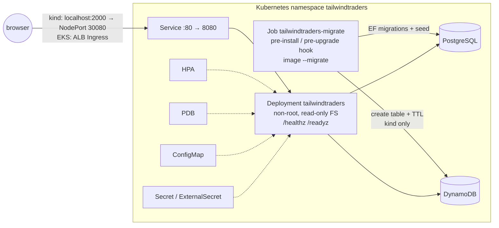

# Kubernetes: kind (local) and Amazon EKS

Phase 4 ([ADR 0009](adr/0009-eks-and-helm.md)). The chart is in [`deploy/helm/tailwindtraders`](../../deploy/helm/tailwindtraders) and replaces the legacy AKS/Dev Spaces chart (old `networking.k8s.io/v1beta1` Ingress).



## What's in the chart
| Template | Notes |
|---|---|
| `deployment.yaml` | UID 1654 (non-root), `readOnlyRootFilesystem`, `drop: [ALL]`, no privilege escalation, seccomp `RuntimeDefault`, `/tmp` emptyDir, port 8080. Probes: startup and liveness on `/healthz` (process only); **readiness on `/readyz`** (PostgreSQL reachable and seeded, DynamoDB table ACTIVE). Requests plus a memory limit, rolling update `maxUnavailable: 0`, zone topology spread, and config/secret checksums trigger a rollout when either changes. |
| `migrate-job.yaml` | **Helm `pre-install,pre-upgrade` hook**: same image, `--migrate` (EF Core migrations, idempotent CSV seed, DynamoDB table if `Cart__CreateTable=true`). Install/upgrade fails if it fails. |
| `configmap.yaml` | Non-secret env (`config:` values). It's a hook resource (weight -10), so the migrate Job can use it. |
| `secret.yaml` / `externalsecret.yaml` | `secrets.mode`: `secret` (chart-created, local only), `externalSecret` (External Secrets Operator ← AWS Secrets Manager; builds `ConnectionStrings__Products` from the Aurora-managed secret JSON), or `existing`. |
| `serviceaccount.yaml` | Dedicated SA. EKS Pod Identity association, or set the IRSA `eks.amazonaws.com/role-arn` annotation. |
| `service.yaml`, `ingress.yaml` | `ingress.className` configurable (`alb` on EKS). Ingress disabled on kind (NodePort instead). |
| `hpa.yaml`, `pdb.yaml` | autoscaling/v2 on CPU. PDB `maxUnavailable: 1`. |

Hook resources (ConfigMap, Secret, ExternalSecret, the Job) are **not deleted by `helm uninstall`**. Delete the namespace for a full cleanup.

## Run on kind (macOS Apple Silicon or Linux)
Prerequisites: Docker Desktop (about 6 GB of memory is enough) and `brew install kind helm kubectl`.
```bash
git clone https://github.com/zander-zilla/TailwindTraders-Website && cd TailwindTraders-Website
scripts/kind-up.sh          # cluster "tailwindtraders", native-arch image build + kind load, deps, helm install
open http://localhost:2000  # /healthz, /readyz
kubectl -n tailwindtraders get pods,jobs
scripts/kind-up.sh --down   # delete the cluster
```
`kind-up.sh` is idempotent. Re-run it after code changes: it rebuilds the image, runs `helm upgrade` (the pre-upgrade migrate hook runs again and reports "Seeding not required") and restarts the pods.
- `deploy/kind/kind-config.yaml`: one node, host `127.0.0.1:2000` → NodePort 30080.
- `deploy/kind/dependencies.yaml`: `postgres:17` and `amazon/dynamodb-local` (both multi-arch), ephemeral. They're applied before the chart because the pre-install hook needs them.
- The compose stack (`docker compose … up`) also uses port 2000. Stop it first (`docker compose -f docker-compose.standalone.yml down`), or change `hostPort`.

## What EKS needs (Phase 5 IaC)
`values-eks.yaml` is ready but untested until this infrastructure exists:
1. **EKS** cluster (1.30+, Auto Mode optional) with the **AWS Load Balancer Controller**, the **EKS Pod Identity Agent** add-on, **External Secrets Operator**, a `ClusterSecretStore` named `aws-secrets-manager`, and **metrics-server** (for the HPA).
2. **ECR** repository `tailwindtraders/web`. Images are pushed by GitHub Actions through OIDC (ADR 0010), with immutable tags.
3. **Aurora PostgreSQL** with an RDS-managed master secret in Secrets Manager. The app connects with `SSL Mode=Require`. (Later: a dedicated least-privilege DB user.)
4. **DynamoDB** table `tt-cart`: PK `userId` (S), SK `productId` (N), on-demand, TTL on `expiresAt` (`Cart__CreateTable=false`).
5. **IAM role** for the `tailwindtraders-web` ServiceAccount (Pod Identity association) with `dynamodb:Query, GetItem, UpdateItem, DeleteItem, DescribeTable` on the table ARN. ESO needs its own role with `secretsmanager:GetSecretValue` on the two secrets.
6. **ACM certificate** and DNS for `ingress.host`.
Then:
```bash
helm upgrade --install tailwindtraders deploy/helm/tailwindtraders -n tailwindtraders --create-namespace \
  -f deploy/helm/tailwindtraders/values-eks.yaml --set image.tag=<git-sha> --wait
```

## Validation (Phase 4)
- `helm lint --strict` (kind and EKS values), `helm template`, and **kubeconform** (Kubernetes 1.33 schemas + the ExternalSecret CRD schema): all objects valid.
- CI `kubernetes` workflow: creates a kind cluster (`helm/kind-action`, same `kind-config.yaml`) and runs **`scripts/kind-up.sh`**. It then checks `/healthz`, `/readyz`, the product list (8 home products), product detail, the SPA and a cart round-trip against DynamoDB Local; asserts the pod hardening fields and the migrate Job logs; and runs `helm upgrade` to show the pre-upgrade hook is idempotent.
- The agent box can't run kind (nested Docker: kubeadm can't reach the API server), so the real install is verified in CI.
