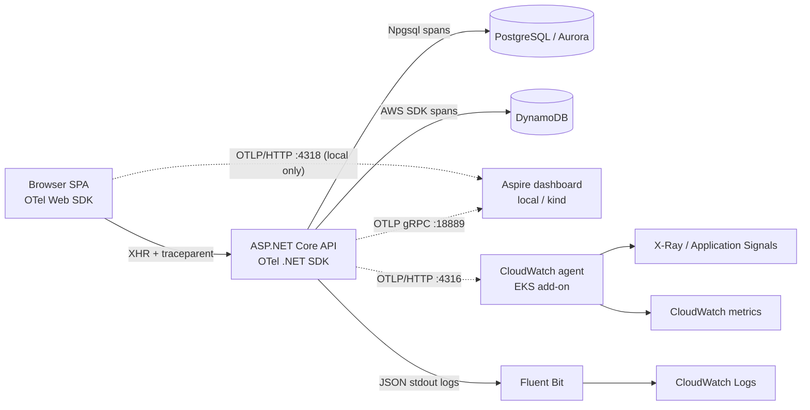

# Observability: OpenTelemetry (Phase 6)

Decision record: [ADR 0012](adr/0012-opentelemetry-observability.md). No screenshots are needed. Follow these steps and you'll see the same thing live.



## What is instrumented
| Signal | Source | Examples |
|---|---|---|
| Traces | ASP.NET Core (server spans; `/healthz`, `/readyz` and static files are filtered out), HttpClient, **Npgsql** (every SQL statement EF Core runs), **AWS SDK** (`DynamoDB.UpdateItem`, `Query`, ...), app spans | `POST api/v1/ShoppingCart` → `cart.add` → `postgresql` (price lookup) + `DynamoDB.UpdateItem` |
| App spans | `TailwindTraders.Web` | `cart.get/add/update/delete` (tags: operation, result, product id, qty; **no user id**), `image_search` → `image_search.classify` (term, result count) |
| Metrics | ASP.NET Core, HttpClient, .NET runtime, Npgsql, AWS SDK, app meter | `tailwindtraders.cart.operations{operation,result}`, `tailwindtraders.cart.units_added`, `tailwindtraders.image_search.requests{result}`, `tailwindtraders.image_search.duration` |
| Logs | JSON console (stdout) with `TraceId`/`SpanId` in `Scopes`; OTLP logs when an endpoint is set (not in EKS) | |
| Browser | `@opentelemetry/sdk-trace-web`: document load, XHR, fetch | `documentLoad`, `HTTP POST` → continues into the API trace |

## Configuration (standard OpenTelemetry env vars)
| Variable | compose / kind | EKS (`values-eks.yaml`) |
|---|---|---|
| `OTEL_EXPORTER_OTLP_ENDPOINT` | `http://aspire-dashboard:18889` | (per-signal below) |
| `OTEL_EXPORTER_OTLP_PROTOCOL` | `grpc` | `http/protobuf` |
| `OTEL_EXPORTER_OTLP_TRACES_ENDPOINT` | | `http://cloudwatch-agent.amazon-cloudwatch:4316/v1/traces` |
| `OTEL_EXPORTER_OTLP_METRICS_ENDPOINT` | | `http://cloudwatch-agent.amazon-cloudwatch:4316/v1/metrics` |
| `OTEL_LOGS_EXPORTER` | (otlp) | `none` (stdout → Fluent Bit) |
| `OTEL_TRACES_SAMPLER` / `_ARG` | always on | `parentbased_traceidratio` / `0.25` |
| `OTEL_SERVICE_NAME`, `OTEL_RESOURCE_ATTRIBUTES` | `tailwindtraders-web`, `deployment.environment.name=compose\|kind` | `…=eks` |
| `BrowserTelemetry__OtlpTracesEndpoint` | `http://localhost:4318/v1/traces` | empty (off) |

With no endpoint set, nothing is exported (for example in tests or a bare `dotnet run`).

## See it locally: Docker Compose (Mac)
```bash
cd ~/TailwindTraders-Website && git pull
cd TailwindTraders.Website/Source
docker compose -f docker-compose.standalone.yml up -d --build --remove-orphans
```
1. Open the shop at **http://localhost:2000**. Log in (any email/password), open a product, **add it to the cart**, change the quantity, and try image search from the home page.
2. Open the dashboard at **http://localhost:18888** (no login). Then:
   - **Traces**: pick a `tailwindtraders-spa: HTTP POST` trace. You'll see browser span → `POST api/v1/ShoppingCart` → `cart.add` → `postgresql` (catalog price lookup) and `DynamoDB.UpdateItem`.
   - **Structured logs**: filter by trace id, or click "View logs" from a span.
   - **Metrics**: `tailwindtraders-web` → `tailwindtraders.cart.operations`, `http.server.request.duration`, `dotnet.gc.*`.
   - The `tailwindtraders-migrate` resource shows the one-shot migration run (EF Core SQL).
3. Command-line check (the same check CI runs):
   `curl -s "http://localhost:18888/api/telemetry/traces?limit=50" | jq '[.data.resourceSpans[].scopeSpans[].scope.name]|unique'`
4. Stop with `docker compose -f docker-compose.standalone.yml down`. Telemetry is in memory, so it's cleared too.

Ports used on the Mac: 2000 (shop), 18888 (dashboard UI), 4318 (OTLP/HTTP for browser spans), 5432, 8000.

## See it on kind (Mac)
```bash
cd ~/TailwindTraders-Website && git pull
scripts/kind-up.sh --down   # only if the cluster was created before Phase 6 (new port mappings 18888/4318)
scripts/kind-up.sh
```
Open http://localhost:2000 and **http://localhost:18888**. The dashboard runs in-cluster (`deploy/kind/dependencies.yaml`), and pods export to `aspire-dashboard:18889`. Stop the compose stack first, since both use ports 2000, 18888 and 4318.

## AWS (EKS): CloudWatch / X-Ray
- Terraform (`infra/terraform/eks.tf`) installs the **`amazon-cloudwatch-observability`** EKS add-on with a Pod Identity role (`CloudWatchAgentServerPolicy` + `AWSXrayWriteOnlyAccess`).
- After the deploy (see [aws-setup.md](aws-setup.md)):
  - **X-Ray / CloudWatch → Application Signals → Services → `tailwindtraders-web`**: service map with Aurora and DynamoDB as dependencies, latency/error SLOs, traces (25 % sampled).
  - **CloudWatch → Container Insights**: pod/node CPU, memory, restarts.
  - **CloudWatch Logs** → `/aws/containerinsights/<cluster>/application`: JSON logs. Logs Insights: `fields @timestamp, Message, Scopes.0.TraceId | filter Category like /ShoppingCart/`.
  - **CloudWatch Metrics** (namespace set by the agent): `tailwindtraders.cart.operations` etc.
- Application Signals' "enable for workload" auto-instrumentation annotation is **not** used: the app is already instrumented with the SDK. The agent's OTLP endpoint (`:4316`) is the supported input for SDK-instrumented apps.
- Alternative: an ADOT collector (EKS add-on `adot`) for fan-out to other backends. Only the `OTEL_EXPORTER_OTLP_*` values change.
- Cost note: Application Signals/X-Ray bill per span and request, so tune `OTEL_TRACES_SAMPLER_ARG`. Container Insights bills per metric and log volume (see aws-setup.md).

## Resilience
- `HttpEndpointSearchTermPredictor` (optional external image classifier) uses a named `HttpClient` with **`AddStandardResilienceHandler()`**: total request timeout, retry with exponential backoff and jitter, circuit breaker, per-attempt timeout. Its spans show each retry attempt.
- PostgreSQL: Npgsql/EF Core connection pooling. DynamoDB: AWS SDK built-in retries (standard mode). Health: `/healthz` (liveness) and `/readyz` (PostgreSQL + DynamoDB) from Phase 4.

## Verification
- Unit/integration test `TelemetryTests` checks:
  - TracerProvider/MeterProvider are registered.
  - A request with a W3C `traceparent` produces `cart.add` **in the caller's trace**, with ASP.NET Core, **Npgsql** and **AWS SDK** spans nested under it.
  - `tailwindtraders.cart.operations` and `units_added` are recorded.
- CI `compose` and `kind` jobs query the dashboard API and require `TailwindTraders.Web`, `Npgsql` and `AWSSDK.DynamoDB` spans.
- Manual run on the agent box: one cart add with `traceparent` produced a single trace: `POST api/v1/ShoppingCart` → `cart.add` → Npgsql `CONNECT` + 2 × `postgresql` → `DynamoDB.UpdateItem` (+ HTTP + credentials spans).
